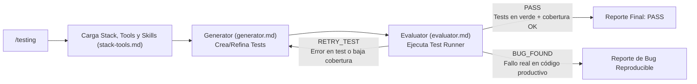

# Plantilla Agéntica: Patrón Evaluator-Optimizer para Testing y Detección de Bugs

Esta plantilla implementa el patrón **Evaluator-Optimizer** (propuesto por Anthropic en *Building Effective Agents*) enfocado en **generar tests automatizados, ejecutarlos contra el entorno real y detectar bugs en el código de producción**.

Está diseñada bajo el principio de **Fuente Única de Verdad (Single Source of Truth)**: la lógica agéntica vive en `.agents/skills/evaluator-optimizer-testing/` con archivos breves y precisos (*progressive disclosure*), mientras que los distintos *harnesses* (**AGY CLI**, **Claude Code**, **OpenCode**, **Windsurf/Cursor**) la consumen mediante adaptadores ligeros y el comando `/testing`.

---

## 1. Estructura de Archivos

```text
.
├── AGENTS.md                                      # Regla raíz universal (AGY CLI, OpenCode, Cursor, Codex)
├── README.md                                      # Guía de implementación por harness
├── .agents/
│   ├── workflows/
│   │   └── testing.md                             # Comando /testing para AGY IDE / Windsurf
│   └── skills/
│       └── evaluator-optimizer-testing/
│           ├── SKILL.md                           # Orquestador del bucle Evaluator-Optimizer
│           └── references/
│               ├── stack-tools.md                 # Sección de Skills, Herramientas (MCP/CLI) y Stack
│               ├── generator.md                   # Rol Generator/Optimizer (escribe y refina tests)
│               └── evaluator.md                   # Rol Evaluator (ejecuta tests y clasifica fallos/bugs)
├── .claude/
│   └── commands/
│       └── testing.md                             # Comando /testing para Claude Code
└── .opencode/
    └── commands/
        └── testing.md                             # Comando /testing para OpenCode
```

---

## 2. Cómo funciona el Bucle Evaluator-Optimizer



1. **Generator (`references/generator.md`):** Diseña pruebas para *happy paths*, casos borde (*edge cases*) y manejo de errores. **Regla de oro:** Tiene prohibido modificar el código de producción para forzar que un test pase.
2. **Evaluator (`references/evaluator.md`):** Ejecuta el *test runner* en la terminal y clasifica el resultado en tres veredictos posibles:
   - `PASS`: Suite en verde y ramas críticas cubiertas.
   - `RETRY_TEST`: El test tiene un error propio (imports, sintaxis, mocks mal configurados) o falta cubrir ramas lógicas $\rightarrow$ vuelve al Generator (máx. 3 iteraciones).
   - `BUG_FOUND`: El test es válido pero el código productivo falla $\rightarrow$ detiene el bucle y entrega la evidencia del bug.

---

## 3. Cómo Configurar tu Stack, Herramientas y Skills

Edita únicamente el archivo [`.agents/skills/evaluator-optimizer-testing/references/stack-tools.md`](./.agents/skills/evaluator-optimizer-testing/references/stack-tools.md) para adaptarlo a tu proyecto:

- **Stack y Test Runner:** Define si usas `vitest`, `jest`, `pytest`, `go test`, `cargo test` o `dotnet test`.
- **Herramientas y MCPs:** Declara servidores MCP activos (por ejemplo, `playwright` para E2E o `postgres` para pruebas de integración).
- **Llamada a otros Skills:** Indica qué skills complementarios de tu carpeta `.agents/skills/` deben invocarse antes (ej. `security-check`), durante (ej. `mock-generator`) o después del test.

---

## 4. Implementación según el Harness (CLI / IDE)

### A. Google Antigravity (`agy` CLI / Antigravity IDE)
Antigravity descubre automáticamente `AGENTS.md` y cualquier skill dentro de `.agents/skills/`.

1. **Instalación:** Copia la carpeta `.agents/` y el archivo `AGENTS.md` en la raíz de tu repositorio (o globalmente en `~/.gemini/config/`).
2. **Cómo llamarlo:**
   - **Comando directo (Workflow):** Escribe `/testing src/miModulo.ts` (usa `.agents/workflows/testing.md`).
   - **Lenguaje natural (Auto-Skill):** Pide *"realiza tests y revisa si hay bugs en `src/miModulo.ts`"*. El agente activará automáticamente el skill `evaluator-optimizer-testing` y podrá usar `invoke_subagent` para aislar al Evaluador.

### B. Claude Code (`claude`)
Claude Code utiliza la carpeta `.claude/commands/` para registrar *slash commands* personalizados y `CLAUDE.md` para reglas de proyecto.

1. **Instalación:**
   - Asegúrate de mantener `.agents/skills/evaluator-optimizer-testing/` y `.claude/commands/testing.md` en tu proyecto.
   - *(Opcional)* Si deseas que también se active sin usar el comando `/testing`, agrega esta línea en tu `CLAUDE.md`:
     ```markdown
     @AGENTS.md
     ```
2. **Cómo llamarlo:**
   - Ejecuta en la terminal interactiva de Claude Code:
     ```text
     /testing src/services/auth.ts
     ```
   - Claude Code inyectará la ruta en `$ARGUMENTS` y ejecutará el ciclo usando la herramienta `Bash` y/o subagentes (`Task`).

### C. OpenCode (`opencode`)
OpenCode lee nativamente el archivo `AGENTS.md` en la raíz del proyecto y registra comandos personalizados desde `.opencode/commands/`.

1. **Instalación:**
   - Mantén `AGENTS.md`, `.agents/` y `.opencode/commands/testing.md` en la raíz del repositorio (o mueve `testing.md` a `~/.config/opencode/commands/` para tenerlo global).
2. **Cómo llamarlo:**
   - Dentro de OpenCode, ejecuta:
     ```text
     /testing src/utils/parser.py
     ```
   - OpenCode expandirá las referencias `@.agents/skills/...` y correrá el bucle Evaluator-Optimizer.

### D. Otros Entornos (Cursor, Windsurf, Codex CLI)
- **Windsurf:** Reconoce automáticamente `AGENTS.md` y habilita el comando `/testing` si copias `.agents/workflows/testing.md` en `.windsurf/workflows/testing.md`.
- **Cursor / Codex CLI:** Leen nativamente `AGENTS.md` en la raíz del proyecto. Basta con escribir en el chat: *"Aplica el flujo de testing sobre `<archivo>`"*.
